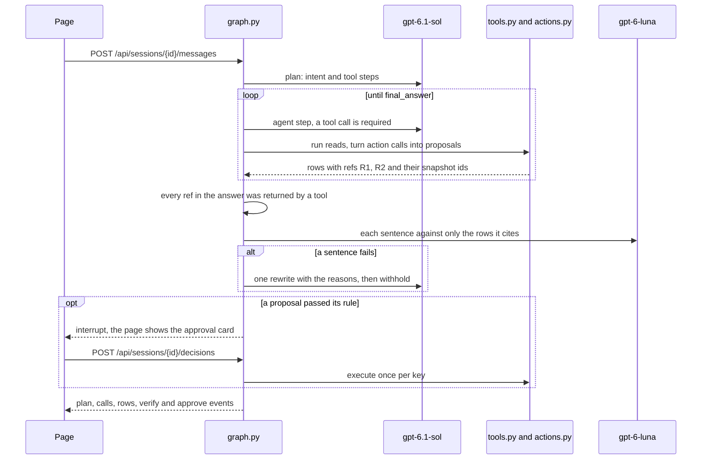

# app

The copilot: a LangGraph agent behind a FastAPI service.

## Modules

```mermaid
flowchart TD
    main[main.py<br/>API and live stream] --> graph[graph.py<br/>plan, agent, act, verify, approve]
    cli[cli.py<br/>terminal chat] --> graph
    graph --> prompts[prompts.py<br/>instructions]
    graph --> tools[tools.py<br/>read tools and detectors]
    graph --> actions[actions.py<br/>action tools and evidence rules]
    graph --> store[store.py<br/>audit log and executed actions]
    tools --> fleet[fleet.py<br/>typed snapshots per company]
    actions --> fleet
```

| File | Job |
|---|---|
| `main.py` | Routes, the server sent event stream, serves the page in `ui/` |
| `graph.py` | The five nodes, the answer schema and the judge call |
| `tools.py` | `find_devices`, `device_history`, `detect_patterns`, `fleet_overview`, paging |
| `actions.py` | The four action tools, the rule each must pass, the duplicate key |
| `fleet.py` | Loads the telemetry into typed snapshots, split by company at load |
| `store.py` | SQLite audit table with triggers that refuse updates and deletes, actions executed once per key |
| `prompts.py` | Planner, agent and judge instructions, with the definitions taken from settings |
| `config.py` | Settings |
| `cli.py` | Chat in the terminal, approvals as y/N |
| `synth.py` | Generates the telemetry, see [data](../data/README.md) |

## One question



The company comes from the session, which the server binds when it opens. It travels in LangGraph's runtime context, which the model cannot write. No tool takes a company argument. State is checkpointed to SQLite after every step, so an approval can arrive after a restart.

## Read tools

Each returns a count row first, then one row per device or finding. Every row carries the snapshot ids it was computed from.

| Tool | Arguments | Returns |
|---|---|---|
| `find_devices` | page, sort by, OS name, OS major below, model, laptops only, disk used at least, memory used at least, failing check, failing severity, battery condition, software, employee | Count with breakdowns by model and OS, then each match's latest reading |
| `device_history` | device id, metric (disk, memory, battery, compliance, software, OS) | The daily series with first, last, min, max, mean and missing days |
| `detect_patterns` | page, pattern (battery end of life, memory pressure, low storage, compliance drift, new software, data gaps) | The definition used, the date window, devices checked and found, then one finding per device |
| `fleet_overview` | none | Device, laptop, OS and failing-check counts |

`find_devices` and `detect_patterns` return one page of `PAGE_ROWS` rows (25), ranked: fullest disk, most charge cycles, longest failing, newest install. The count row holds the total, the ranking, the page, the number of pages and the breakdowns over every match. The agent gives the total from the count row and fetches another page only when asked.

## Action tools

Each takes `refs` to the rows that justify it. Code decides whether it goes to a person.

| Tool | Reaches a person when |
|---|---|
| `create_upgrade_order(device_id, component, spec)` | The matching condition (low disk, memory pressure, battery needing service) held in each of the last 3 snapshots |
| `open_remediation_ticket(device_id, check_id, note)` | The check failed in each of the last 3 snapshots |
| `flag_device_for_replacement(device_id, reason)` | Two or more lasting hardware problems. One problem gets an upgrade instead |
| `notify_employee(employee_id, message)` | One of the employee's devices has a lasting problem |

Every action is also refused when the target is not in the company, when it cites no refs or unknown refs, when none of the cited rows is about the target, or when the same action was already proposed or carried out. The key is a SHA-256 of company, kind, target and component or check.

## Configuration

Every setting has a default in `config.py` and can be overridden by an environment variable or `.env`.

| Setting | Default | Meaning |
|---|---|---|
| `OPENAI_API_KEY` | | Required for live runs |
| `MODEL` | `gpt-6.1-sol` | Planner and agent |
| `JUDGE_MODEL` | `gpt-6-luna` | Reads each answer sentence against its cited rows |
| `MAX_STEPS` | 12 | Agent steps before only `final_answer` is offered |
| `REWRITES` | 1 | Times an unsupported answer goes back to the agent |
| `LOW_DISK_USED` | 90 | Percent of the system volume used that counts as low on disk |
| `HIGH_MEMORY_USED` | 85 | Percent of RAM in use that counts as memory pressure |
| `CONSISTENT_SHARE` | 0.8 | Share of a device's snapshots that makes a condition consistent |
| `BATTERY_CYCLE_LIMIT` | 1000 | Charge cycles at which a battery counts as near end of life |
| `EVIDENCE_DAYS` | 3 | Snapshots in a row a condition must hold before an action may cite it |
| `PAGE_ROWS` | 25 | Rows a list tool returns per page, after its count row |
| `DATA` | `data/telemetry.jsonl` | Telemetry, one snapshot per line |

## Design decisions

- **An explicit `StateGraph`** over a prebuilt ReAct agent. Plan, verify and approve are nodes that can be tested, routed and checkpointed. The cost is more code than `create_agent`.
- **A plan step** costs one model call per message. It routes other-company and out-of-scope messages before any tool runs.
- **`final_answer` is a tool** whose schema is a list of sentences with refs, so code can check every ref. The page shows the answer once it is checked, so it does not stream token by token.
- **Code decides what is a trend and whether an action is justified.** The model cannot argue past a rule, and the rules are unit tested. A rule is narrower than judgement: "replace this laptop because it is slow" is refused even if a person would agree.
- **A cheaper judge.** `gpt-6-luna` costs a twentieth of `gpt-6.1-sol`. The eval audits it with the stronger model.
- **One rewrite, then withhold.** A sentence that still fails is dropped and the page says how many were withheld.
- **SQLite for checkpoints and audit.** No server to run. Production would use Postgres, an external sink for the audit log and real sign-in in place of the company picker.
- **Telemetry in memory.** 10,025 devices load in about 21 s with 1.9 GB. A larger fleet should query a database with an index per company and device.
